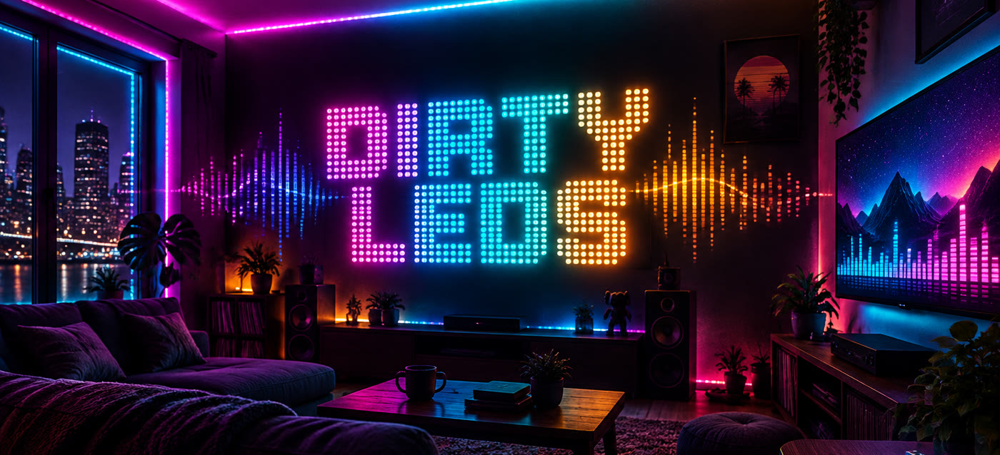
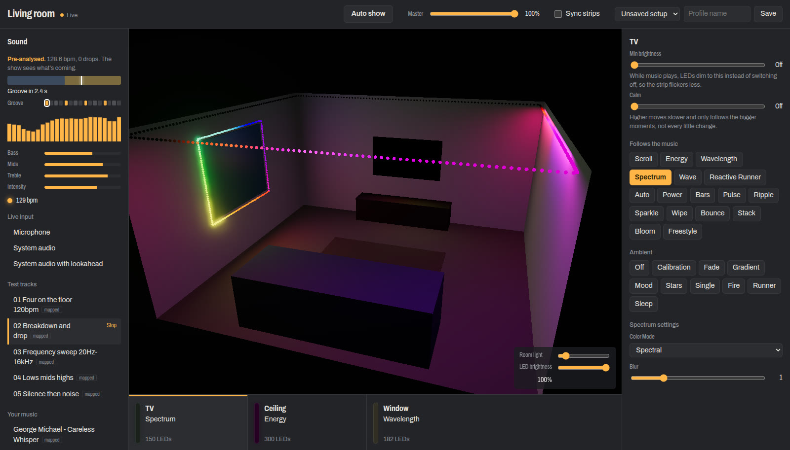
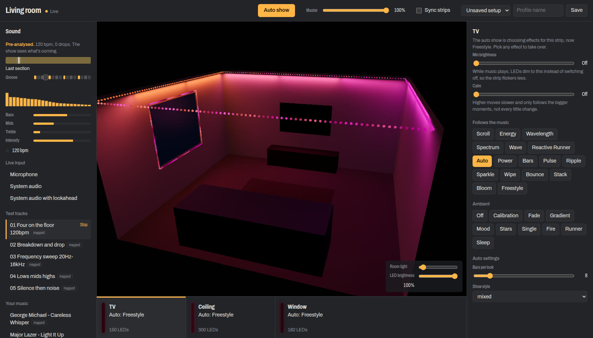
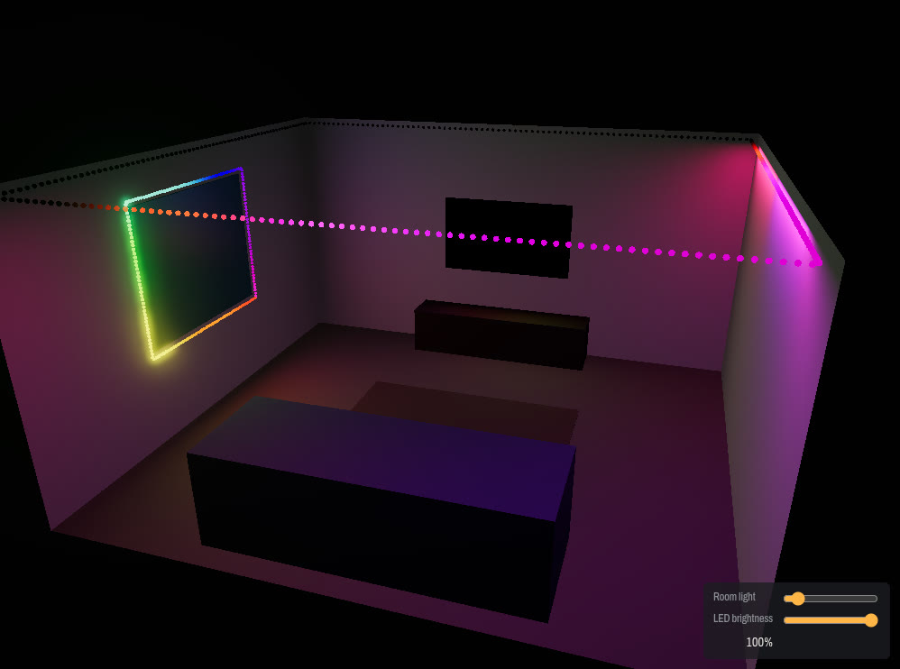

<p align="center">
  
</p>

<h1 align="center">dirty-leds</h1>

<p align="center">
  <b>Music reactive WS2812B LED strips, driven by cheap ESP8266s over WiFi.</b><br>
  A Python engine listens to your music, a web app shows your room in 3D, and an auto show plans out the whole song like a lighting tech.
</p>

<p align="center">
  <a href="#-quick-start">Quick start</a> ·
  <a href="#-hardware">Hardware</a> ·
  <a href="#-esp8266-firmware">Firmware</a> ·
  <a href="#-the-web-app">Web app</a> ·
  <a href="#-auto-show">Auto show</a> ·
  <a href="#-simulator">Simulator</a> ·
  <a href="#-home-assistant">Home Assistant</a>
</p>

---



## ✨ What it does

* **Reacts to any music.** It can follow the mic, whatever your PC is playing (PipeWire), a track file, or a raw PCM pipe from Spotify Connect (librespot) or AirPlay (shairport-sync).
* **Lots of effects.** 17 effects follow the music (Scroll, Energy, Spectrum, Wavelength, Pulse, Ripple, Sparkle, Bloom, Freestyle...) and 10 ambient ones (Fade, Gradient, Mood, Fire, Stars, Sleep...). Every effect has its own settings.
* **Auto show.** It picks effects for every strip in time with the beat. It builds into drops and goes dark just before them, then hits on the beat the drop lands on. With tracks, or with *lookahead* on system audio, it hears the music before you do.
* **A 3D room view.** Your strips are drawn in a 3D model of your room, lit with the exact frames being sent to the hardware.
* **Simulator.** You don't need any LEDs to build effects.
* **Per strip tuning.** Each strip gets *Calm* (smooths out flicker, follows only the big moves) and *Min brightness* (dims instead of going black while music plays).
* **Profiles.** Save a whole setup ("Cooking", "Party"...) and switch back to it in one click.
* **Home Assistant integration.** Lights, a media player, selects, sliders, sensors and the full web app in the HA sidebar.
* **Fast.** NumPy rendering and shared audio analysis keep it inside the 60 fps frame budget.

---

## 🚀 Quick start

No LEDs yet? This runs a simulated living room with a test track:

```bash
git clone https://github.com/uen/dirty-leds.git && cd dirty-leds

cd web && yarn install && yarn build && cd ..
cd python && pip install -r requirements.txt
python3 main.py --config rooms/living-room.json --audio "track:test/01 Four on the floor 120bpm.wav"
```

Then open **http://127.0.0.1:6923** and press **Auto show**.

**Requirements:** Python 3, Node 20+ with yarn, and ffmpeg (for playing tracks). On Linux, PipeWire's `pw-record` lets the lights follow whatever your PC plays. `pyaudio` is only needed for the microphone.

---

## 🔌 Hardware

| Part | Notes |
|---|---|
| **ESP8266** | NodeMCU, Wemos D1 mini or an ESP-01. One per strip. |
| **WS2812B strip** | Or WS2812 or any FastLED chipset (change `CHIPSET` / `COLOR_ORDER` in the sketch). |
| **5V power supply** | Budget about 60 mA per LED at full white. 150 LEDs is about 9 A worst case, though music rarely gets near that. |
| Optional | A 330 Ω resistor on the data line and a 1000 µF capacitor across the strip's power. |

### Wiring

```
              ┌──────────────────────┐
  PSU +5V ────┤ LED strip  5V        │
          └───┤ ESP8266    VIN / 5V  │
              │                      │
  PSU GND ────┤ LED strip  GND       │
          └───┤ ESP8266    GND       │   ← shared ground is a must
              │                      │
  ESP RX ─────┤ LED strip  DATA (DIN)│   RX = GPIO3
              └──────────────────────┘
```

* Data goes out on the **RX pin (GPIO3)**, so serial is TX only. The ESP-01 has very few pins, and this pin works on all boards.
* If your LEDs flicker at the far end, feed power into both ends of long strips.
* If the colours come out in the wrong order (red shows as green), change `COLOR_ORDER` (default `GRB`).

### How it talks

The ESP is just a dumb, fast display. Every frame, the Python app sends **one UDP packet** to the ESP on port `7778`. The packet is raw `R G B R G B ...` bytes, 3 per LED. The ESP checks the size, copies the bytes into FastLED and calls `show()`. All the thinking happens on your computer, so effects can do as much as they like.

```
 music ─▶ Python (FFT · mel bins · beat/tempo · song structure · effects) ─UDP─▶ ESP8266 ─▶ WS2812B
                        │
                        └──▶ web app (SSE) · Home Assistant
```

---

## 📟 ESP8266 firmware

The sketch is in `arduino/ws2812_controller/`. It uses the esp8266 core and **FastLED**, and supports **OTA updates**, so after the first flash you never need the USB cable again.

1. Copy `secrets.h.example` to `secrets.h` and fill in your WiFi details and an OTA password. `secrets.h` is gitignored.
2. Set each strip's LED count, IP and name as build flags. You don't need to edit the sketch:

```bash
cd arduino/ws2812_controller
arduino-cli compile --fqbn esp8266:esp8266:nodemcuv2 \
  --build-property 'compiler.cpp.extra_flags=-DNUM_LEDS=150 -DIP_LAST=174 -DSENSOR_NAME="Strip5"' .
arduino-cli upload --fqbn esp8266:esp8266:nodemcuv2 -p /dev/ttyUSB0 .
```

| Flag | Meaning | Default |
|---|---|---|
| `NUM_LEDS` | LEDs on this strip | `250` |
| `IP_LAST` | Last number of its static IP, `192.168.1.<IP_LAST>` | `112` |
| `SENSOR_NAME` | WiFi hostname and OTA name | `dirty-leds` |

The network is set to `192.168.1.x` with the router at `.254`. If yours is different, change `ip` / `gateway` in the sketch.

---

## ⚙️ Server setup

```bash
cd python && pip install -r requirements.txt
cd ../web && yarn install && yarn build
```

Add your strips to `python/config.json`:

```json
{
    "devices": [
        {
            "name": "Window",
            "type": "ESP8266",
            "ip": "192.168.1.170",
            "port": 7778,
            "leds": 300,
            "minBrightness": 0.1,
            "calm": 0.3
        }
    ],
    "server": { "host": "0.0.0.0", "port": 6923 },
    "lookahead": 8,
    "pipes": [{ "name": "Spotify", "path": "/tmp/librespot.pcm" }]
}
```

| Key | What it does |
|---|---|
| `devices[].ip` / `port` / `leds` | Must match the firmware build. |
| `devices[].minBrightness` | 0–1. While music plays, LEDs never drop below this. |
| `devices[].calm` | 0–1. Smooths out small, fast changes. |
| `devices[].path` | 3D points the strip runs along, for the room view (see `python/rooms/`). |
| `room` | The room's size and furniture for the 3D view. |
| `server` | Web app host and port. Set `"host": "0.0.0.0"` to control it from your phone. Anyone on your network can then change the lights. |
| `lookahead` | How many seconds the lookahead source delays your audio by. |
| `pipes` | Named PCM FIFOs that show up as audio sources. |

Start it:

```bash
cd python
python3 main.py --audio system        # → http://127.0.0.1:6923
```

### Audio sources

You can switch between these in the web app too.

| `--audio` | Source |
|---|---|
| `off` | Nothing. Ambient effects still run. |
| `mic` | The default microphone |
| `system` | Whatever your PC is playing (PipeWire) |
| `track:<file>` | A file in `python/music/`, looped and played through your speakers. Test tracks are generated in `python/music/test/` on start. |
| `pipe:<path>` | Raw 16-bit mono 48 kHz PCM from a FIFO, e.g. librespot or shairport-sync on a headless box |

### Run it as a service

```bash
cp systemd/dirty-leds.service ~/.config/systemd/user/
systemctl --user daemon-reload && systemctl --user enable --now dirty-leds
```

---

## 🎛️ The web app



* **Header:** Auto show, master brightness, *Sync strips* (all strips play the lead strip's frame), and profiles.
* **Sound:** where the music comes from, a live spectrum, bass/mid/treble/intensity, tempo, and for analysed tracks a track map split into sections. Click the map to jump through the song.
* **Stage:** the 3D room, lit by the real frames. Drag to orbit. Room light and LED brightness sliders.
* **Strips:** pick a strip to edit it. Each strip shows its effect, or what the auto show chose for it.
* **Effects:** Min brightness, Calm, the effect list, and the selected effect's settings (colour mode, blur, mirror, speed...).

---

## 🎬 Auto show

Press **Auto show** and the app directs every strip itself. How well it can plan depends on where the music comes from:

| Source | What the show knows |
|---|---|
| **Tracks in `python/music/`** | It analyses the whole song first (a second or two, then cached). It knows the sections, builds into drops, goes dark just before them and hits on the beat they land on. |
| **System audio with lookahead** | It routes whatever your PC plays (Spotify, a browser...) through the app and on to your speakers 8 s late. The show hears it first, so live music gets the same builds and drops after about the first 25 s of each song. Your normal output comes back when you switch away or stop the app. |
| **Mic / plain system audio** | It reacts live. Drops land when the bass comes in, but there's no darkness before them. |

The show style can be `mixed` (default), `freestyle` or `effects`. Scenes mostly put every strip on one effect together. Sometimes they split the strips up, and sometimes they light one strip at a time and pass it around the room on the beat.

To judge a show without watching it, render it to an image and a score card:

```bash
python3 tools/show_report.py "song.mp3" [--live | --lookahead 8] [--looks]
```

---

## 🧪 Simulator



You don't need any LEDs to work on effects. The presets in `python/rooms/` (`living-room`, `bedroom`, `kitchen`, `flat`) are configs whose strips point at `127.0.0.1`, with a 3D layout of the room:

```bash
cd python
python3 main.py --config rooms/living-room.json --audio "track:test/01 Four on the floor 120bpm.wav"
```

The 3D view shows every LED exactly as the app sends it. Each strip also lights the walls around it, so you can judge how an effect will really look in a dark room. To model your own room, add a `"room"` and a `"path"` per device to your `config.json` (copy from a preset).

The generated test tracks are built to check specific things: steady four on the floor, a breakdown into a drop, a frequency sweep from 20 Hz to 16 kHz, separate lows/mids/highs, and silence followed by noise.

---

## 🏠 Home Assistant

<p>
  
  
</p>

`home-assistant/custom_components/dirty_leds` is a full integration. It uses local push: it follows the app's event stream, so changes in the web app show up in HA straight away.

To try it with HA in Docker (the integration is already mounted in):

```bash
cd home-assistant
sudo docker compose up -d
```

To use it with your existing HA, copy `custom_components/dirty_leds` into your HA `config/custom_components/` and restart.

Then go to **Settings → Devices & services → Add integration → Dirty LEDs** and enter host `127.0.0.1` (or the server's IP) and port `6923`.

| Entity | What it does |
|---|---|
| 💡 **Light: all strips** | On/off, master brightness, effect (including Auto) |
| 💡 **Light per strip** | On/off, effect, and a `showing` attribute with what the auto show picked |
| 🎵 **Media player** | Track and playhead, seeking, audio sources as its sources. Off stops listening. |
| 🔽 **Selects** | Effect and Colours per strip, show style, profile |
| 🎚️ **Numbers** | Min brightness and Calm per strip |
| 🔀 **Switches** | Auto show, Sync |
| 📈 **Sensors** | Tempo and Intensity (Bass, Mid and Treble are there but disabled by default) |
| 🖥️ **Sidebar panel** | **LEDs**: the full web app inside HA |
| 🛠️ **Action** | `dirty_leds.set_option` sets any other effect option, e.g. `{option: speed, value: 7}` |

---

## 🛠️ Developing

Run both halves with live reload. The web app hot-reloads on save (React Fast Refresh), and the Python app restarts whenever a `.py` file changes. The page reconnects by itself.

```bash
cd python
pip install -r requirements-dev.txt
watchfiles --filter python "python3 main.py --config rooms/flat.json" .

cd web
yarn dev    # http://localhost:5173, proxies /api to the Python app
```

### Project layout

```
arduino/ws2812_controller/   ESP8266 firmware (FastLED, UDP, OTA)
python/
  main.py                    frame loop: analyse → render → calm/floor → send
  visualizer.py              effect registry
  effects/                   the effects
  lib/                       audio sources, DSP, features, director + choreography (auto show), API, server
  rooms/                     simulator room presets
  tools/                     benchmark, show report, test track generator
web/                         React + three.js web app
home-assistant/              HA integration + docker-compose
systemd/                     user service
```

### Profiling

To time every effect stage by stage (DSP, render, send) against the 16.7 ms frame budget:

```bash
cd python
python3 tools/benchmark.py --track "test/01 Four on the floor 120bpm.wav" --no-sync
```

To see where the running app spends its time, including the web server, as a flame graph:

```bash
py-spy record -o profile.svg -- python3 main.py --config rooms/flat.json --audio "track:test/01 Four on the floor 120bpm.wav"
```

---

## 💬 Support

Issues and PRs are welcome. For help, or if you want to test new stuff, add me on Discord: **manol#7762**.
